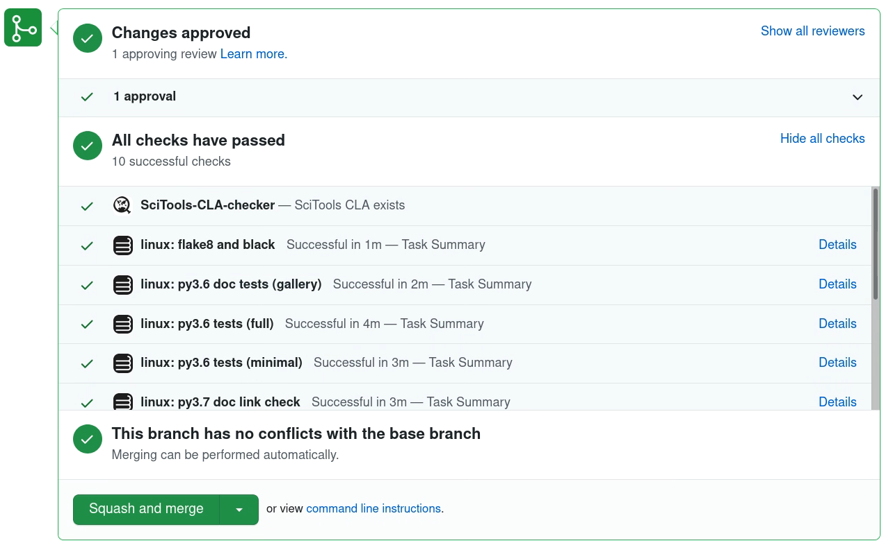

.. include:: ../common_links.inc

.. _developer_testing_ci:

Continuous Integration (CI) Testing
===================================

.. readingtime::

.. note:: Iris is currently supported and tested against |python_support|
          running on Linux.  We do not currently actively test on other
          platforms such as Windows or macOS.

The `Iris`_ GitHub repository is configured to run checks against all its
branches automatically whenever a pull-request is created, updated or merged.
The checks performed are:

* :ref:`testing_gha`
* :ref:`testing_cla`
* :ref:`pre_commit_ci`

.. _testing_gha:

GitHub Actions
**************

Iris unit and integration tests are an essential mechanism to ensure
that the Iris code base is working as expected.  :ref:`developer_running_tests`
may be performed manually by a developer locally. However Iris is configured to
use `GitHub Actions`_ (GHA) for automated Continuous Integration (CI) testing.

The Iris GHA YAML configuration files in the ``.github/workflows`` directory
defines the CI tasks to be performed. For further details
refer to the `GitHub Actions`_ documentation. The tasks performed during CI include:

* running the system, integration and unit tests for Iris
* ensuring the documentation gallery builds successfully
* performing all doc-tests within the code base
* checking all URL references within the code base and documentation are valid

The above GHA tasks are run automatically against all `Iris`_ branches
on GitHub whenever a pull-request is submitted, updated or merged. See the
`Iris GitHub Actions`_ dashboard for details of recent past and active CI jobs.

.. _gha_test_env:

GitHub Actions Test Environment
-------------------------------

Pixi environments, Conda and PyPI dependencies, and tasks are defined in
``pyproject.toml``. The committed ``pixi.lock`` records the resolved package
versions used by CI. CI installs its selected environment in frozen mode, so
it fails if the manifest and lock do not agree.

When changing a dependency, update its Pixi declaration and, when applicable,
the PyPI runtime metadata in ``requirements/pypi-core.txt``. Run
``pixi update`` and include the resulting ``pixi.lock`` in the pull request.
The scheduled GitHub Actions workflow also runs ``pixi update`` and opens a
pull request when the lock changes.

GitHub Checklist
----------------

An example snapshot from a successful GitHub pull-request shows all tests
passing:

If any CI tasks fail, then the pull-request is unlikely to be merged to the
Iris target branch by a core developer.

Data Repositories
-----------------

Two other SciTools repositories support the CI tasks:

* `iris-test-data`_ is a github project containing all the data to support the tests.
* `iris-sample-data`_ is a github project containing all the data to support the gallery and examples.

If new files are required by tests or code examples, they must be added to
the appropriate supporting project via a suitable pull-request.  This pull
request should be referenced in the main Iris pull request and must be
accepted and merged before the Iris one can be.

.. _testing_cla:

`CLA Assistant`_
****************

A bot which checks that the GitHub authors of the pull-request have signed the
|SciTools Contributor's License Agreement (CLA)|_.

.. _pre_commit_ci:

pre-commit CI
*************

A CI service for the `pre-commit`_ framework that checks and auto fixes all
pull-requests given the `Iris`_ GitHub repository `.pre-commit-config.yaml`_.

See the `pre-commit.ci dashboard`_ for details of recent past and active Iris jobs.

.. note::

  The `codespell`_ ``pre-commit`` hook checks the spelling of the whole codebase
  and documentation.  This hook is configured in the ``[tool.codespell]`` section
  of the ``pyproject.toml`` file.

  Append to the ``ignore-words-list`` option any **valid words** that are
  considered **not** a typo and should **not** be corrected by `codespell`_.

ruff
----
As of **Iris 3.8** `ruff`_ has been adopted to ensure our codebase is using best
practice.  `ruff`_ is configured in the `Iris`_ GitHub repository using  
`.pre-commit-config.yaml`_.  

Run `ruff`_ in the Pixi development environment with::

   pixi run --environment dev-py314 ruff check .

.. note::

  The `ruff`_ ``pre-commit`` hook checks for compliance of the whole codebase.
  This hook is configured in the ``[tool.ruff]`` section
  of the ``pyproject.toml`` file.

  Edit the ``.ruff.toml`` file to include any *temporary* rules to be ignored. Edit the ``pyproject.toml`` to include any *permanent* rules to be ignored. We
  aim to be fully `ruff`_ compliant as possible.

For more information on how to use `ruff`_ please see the `ruff documentation`_.

.. _.pre-commit-config.yaml: https://github.com/SciTools/iris/blob/main/.pre-commit-config.yaml
.. _pre-commit.ci dashboard: https://results.pre-commit.ci/repo/github/5312648
.. _CLA Assistant: https://github.com/cla-assistant/cla-assistant
.. |SciTools Contributor's License Agreement (CLA)| replace:: **SciTools Contributor's License Agreement (CLA)**
.. _ruff documentation: https://docs.astral.sh/ruff/tutorial/
