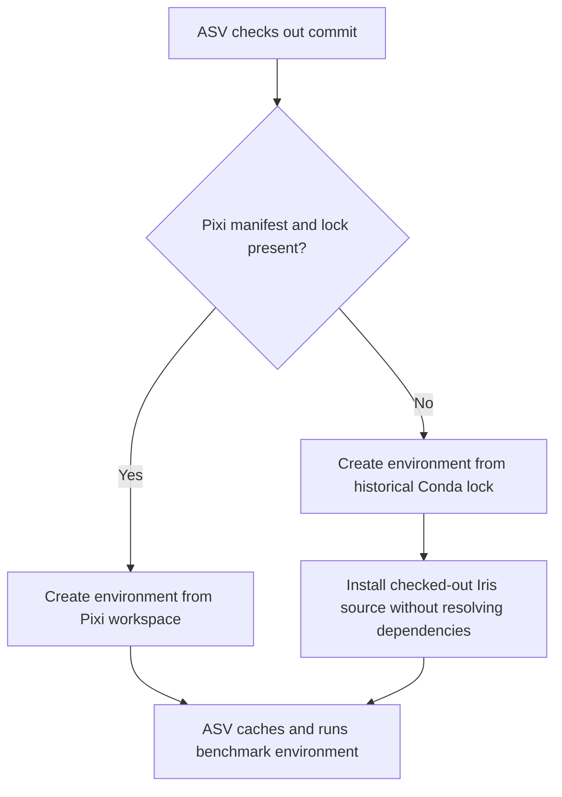
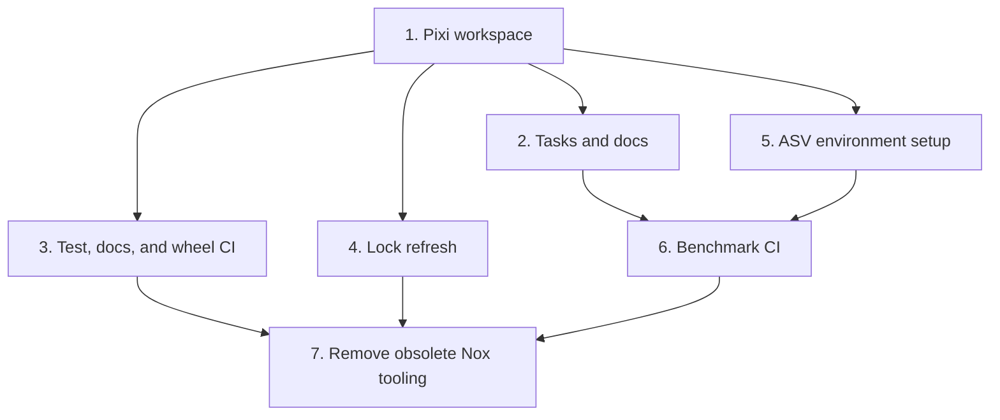

# Pixi Package Management Design

## Intent

Adopt Pixi as the package and environment manager for Iris development and
continuous integration. Replace Nox, the per-Python conda environment files,
and the conda-lock generator with a Pixi workspace, a committed `pixi.lock`,
and named Pixi tasks. This gives contributors one command-line interface for
Conda and PyPI packages, local tasks, CI, and lock updates.

## Goals

- Declare Conda and PyPI environment dependencies in `[tool.pixi]` in
  `pyproject.toml`.
- Provide environments for the supported Python versions 3.12, 3.13, and
  3.14, with separate development, test, documentation, and optional-package
  features.
- Expose the current Nox workflows as named Pixi tasks, including tests,
  doctests, gallery tests, wheel checks, and benchmarks.
- Run CI from frozen Pixi environments and refresh `pixi.lock` through a
  scheduled GitHub Actions workflow that opens a pull request when it changes.
- Remove Nox and the obsolete environment and lock-generation machinery from
  current development and CI workflows.
- Replace root `environment.yml` as the contributor environment definition and
  update source-install, CI, and release guidance to use Pixi.
- Preserve per-commit dependency environments for ASV comparisons, including
  historical commits that predate Pixi.
- Document contributor setup, common Pixi tasks, and lock updates.

## Non-Goals

- Change Iris runtime dependency declarations used to build PyPI
  distributions. `requirements/pypi-core.txt` remains the source of published
  runtime requirements.
- Change supported Python versions, runtime dependency ranges, or CI test
  coverage.
- Change benchmark definitions or how ASV decides which commits to compare.
- Add non-Linux lock targets in this migration. Existing generated locks and
  CI environment caches target `linux-64`.
- Change the Read the Docs-specific environment in
  `requirements/readthedocs.yml`.

## Constraints

- Iris supports Python 3.12, 3.13, and 3.14.
- Conda packages come from conda-forge. Packages unavailable or unsuitable on
  conda-forge may use PyPI through Pixi.
- Distribution metadata must continue to declare PyPI-compatible runtime
  dependencies independently of the Conda packages used in development
  environments.
- GitHub Actions currently runs tests, doctests, gallery tests, and wheel
  checks on Ubuntu. Benchmarks also run on Ubuntu and create a separate data
  generation environment.
- Historical Iris commits contain their own `requirements/locks/*.lock`
  files. Benchmark environment setup must be able to consume those files
  without invoking Nox.
- Lock refresh must preserve the existing reviewable pull-request workflow.

## Approaches

### Pixi for environments and tasks

Define the active development and CI environments, package sources, and
commands in the Pixi workspace. Keep per-commit benchmark environments by
creating environments directly from lockfiles in historical checkouts. This
matches the requested Nox removal and preserves benchmark dependency
isolation. It requires a compatibility path in ASV setup for older commits.

### Pixi with one current benchmark environment

Use Pixi for all environments and run every compared commit with the current
locked dependencies. This is simpler, but dependency changes can alter or
break results for older revisions, so benchmark comparisons no longer isolate
code changes as well.

The selected approach is Pixi for current environments and tasks, with
historical per-commit benchmark environments retained through direct Conda
creation. Nox remains absent from current workflows.

## Design

### Pixi workspace

- Add Pixi workspace configuration to `pyproject.toml` and commit
  `pixi.lock`.
- Define core, development, test, documentation, and optional-package
  features. Map existing optional dependency groups into Pixi features.
- Include optional packages already installed by current CI in test
  environments so existing test coverage remains intact. Let contributors
  select other optional features without adding every integration dependency
  to the default environment.
- Define Python-specific environments for 3.12, 3.13, and 3.14. Give each
  Python version its own solve group, shared by that version's development,
  test, and documentation environments.
- Provide a separate Python 3.14 release-tools environment for building and
  validating PyPI artifacts.
- Use conda-forge packages where suitable and Pixi PyPI dependencies where a
  package should come from PyPI.

### Distribution metadata

- Keep `requirements/pypi-core.txt`, consumed by the package build, as the
  source of published runtime requirements.
- Update Pixi declarations alongside package metadata when a dependency
  appears in both. Do not add a custom synchronization generator.
- Test wheel installation from its declared metadata independently of the
  editable development install.

### Tasks and CI

- Define Pixi tasks for existing test, documentation, wheel, and benchmark
  workflows.
- Provide wheel-check environments that omit the editable Iris installation,
  so wheel tests exercise published PyPI metadata.
- Install each CI job's named environment in frozen mode and run its task
  through Pixi.
- Replace Nox-specific CI environment setup and caching with Pixi
  installation and caching. Keep caches needed by Cartopy or historical
  Conda benchmark environments where Pixi does not replace them.

### Lock refresh

- Replace the shared conda-lock refresh workflow with a Pixi update workflow.
- Run `pixi update`, detect lock changes, and open an automated pull request
  containing `pixi.lock`.
- Use Pixi commands locally to install environments, run tasks, and update
  the lock.

### ASV environments

- Extend the existing ASV environment setup hook in
  `benchmarks/asv_delegated.py`.
- Use the checked-out Pixi manifest and lock to provision current revisions.
- For pre-Pixi revisions, create environments directly from that checkout's
  explicit Conda lockfile, then install its Iris source without resolving
  dependencies again.
- Keep this path Nox-free and isolate environments under ASV's environment
  directory so ASV can cache and reuse them.

### Nox removal

- Remove `noxfile.py`, `tools/update_lockfiles.py`, active
  `requirements/py*.yml` environment definitions, root `environment.yml`,
  generated current lockfiles, and Nox-specific cache actions and
  configuration.
- Update the Makefile, benchmark tools, source-install, CI, release, and
  contributor documentation to use Pixi commands.
- Retain historical lockfiles in Git history for ASV checkouts, but do not
  keep them as active lock inputs on the migrated branch.

## Roadmap

| # | Scope | Status |
|---|---|---|
| 1 | Define Pixi dependencies, features, Python environments, solve groups, and `pixi.lock` | ✅ complete in working tree (2026-11-16) |
| 2 | Add Pixi tasks for tests, docs, wheel checks, and benchmarks; document contributor commands | ✅ complete in working tree (2026-11-16) |
| 3 | Migrate test, docs, and wheel CI to frozen Pixi environments and caching | ✅ complete in working tree (2026-11-16) |
| 4 | Replace scheduled conda-lock refresh with a Pixi lock-update pull request workflow | ✅ complete in working tree (2026-11-16) |
| 5 | Migrate ASV setup to Pixi for current revisions and direct Conda lock installs for historical revisions | ✅ complete in working tree (2026-11-16) |
| 6 | Migrate benchmark CI and remove Nox-based benchmark commands | ✅ complete in working tree (2026-11-16) |
| 7 | Remove obsolete Nox and conda-lock tools, environment files, and update contributor, source-install, CI, and release guidance | 🔄 in progress (2026-11-17; one test-py314 DOT-reference failure remains) |

Rows 2, 3, and 4 depend on row 1. Row 5 depends on row 1, and row 6 depends
on rows 2 and 5. Row 7 follows rows 3, 4, and 6. Update this roadmap as
implementation progresses. Mark completed work as `✅ complete in working
tree (date)`; change it to `✅ landed (date, pull request)` in the pull request
that delivers it. The root
and test `AGENTS.md` files also describe Nox and Conda setup. Update those
instructions as part of row 7 while retaining each file's change-control
meta-instructions. The user approved these edits before implementation.

Task 7's Pixi verification ran in the approved scratch environments. The docs
task passed 908 doctests and the gallery task passed all 25 tests. The test
task passed 12,998 tests with 63 skips and one `test_dot_simple_pp`
`global_pp.dot` mismatch, also observed in `iris-dev`. Skips match the prior
Python 3.14 environment: GeoVista was intentionally absent, and `iris_grib`
and GDAL were not installed. Keep Task 7 in progress until the DOT mismatch is
resolved or accepted as a known baseline issue.

## Verification

- Pixi can install each supported Python environment from `pixi.lock` in
  frozen mode.
- Test environments retain optional integrations currently covered by CI;
  each Python version resolves in its own solve group.
- CI runs tests, doctests, gallery tests, and wheel checks through Pixi tasks
  on their existing Python versions.
- Scheduled lock refresh creates a pull request only when `pixi.lock` changes.
- ASV can prepare both a current Pixi-based revision and a pre-Pixi revision
  without Nox, preserving per-commit dependencies.
- Contributor documentation gives working Pixi installation, task, and lock
  update commands.
- Source-install, CI, and release documentation no longer directs developers
  to create the obsolete root Conda environment.